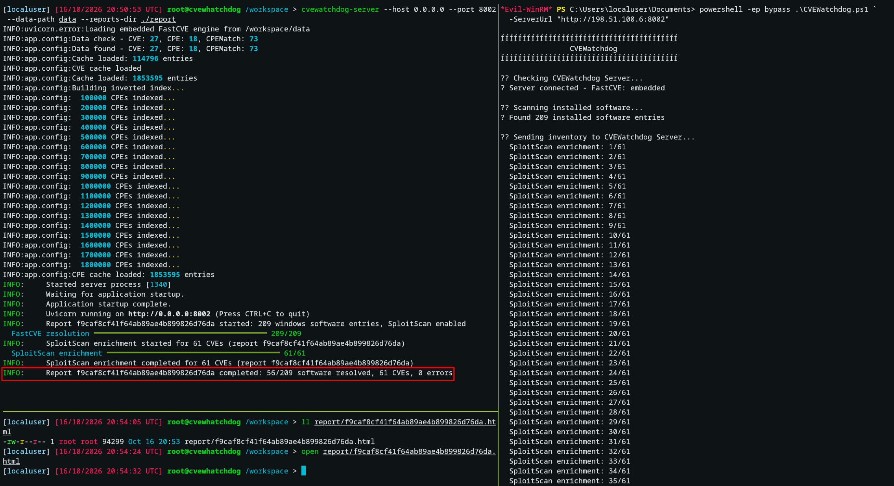
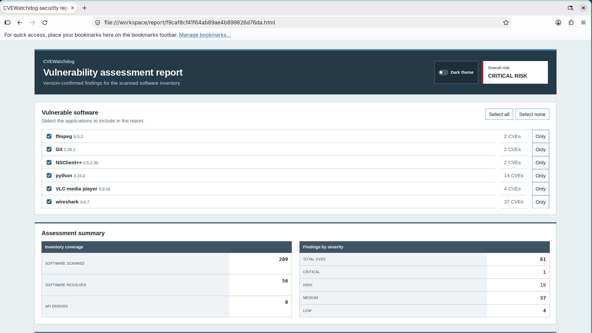

# CVEWatchdog


CVEWatchdog scans installed software for known vulnerabilities and generates a
standalone HTML report. The server includes the FastCVE engine and can enrich
results with SploitScan.

## Features

- Windows and Linux inventory
- Embedded FastCVE engine
- NVD version-range matching
- Filterable HTML reports
- Filters by software, severity, CWE, vulnerability type, and available PoC
- Optional SploitScan enrichment
- Client/server mode for scanning Windows hosts without Python

## Requirements

- Python 3.9 or newer on the server
- PowerShell 5 or newer on Windows clients
- At least 10 GB of free disk space for FastCVE data
- `pipx` for Python installation

## Install

From GitHub:

```bash
pipx install --force git+https://github.com/Goultarde/CVEWatchdog.git
```

From a local clone:

```bash
git clone https://github.com/Goultarde/CVEWatchdog.git
cd CVEWatchdog
pipx install --force .
```

SploitScan is optional:

```bash
pipx install sploitscan
```

## Start the server

```bash
cvewatchdog-server \
  --host 0.0.0.0 \
  --port 8002 \
  --data-path ./fastcve_data \
  --reports-dir ./reports
```

The first start downloads and indexes the NVD data. This can take several
minutes. Check the server with:

```bash
curl http://127.0.0.1:8002/health
```

The server does not provide authentication or TLS. Use it only on a trusted
network or place it behind a secured reverse proxy.

## Windows client

Copy `CVEWatchdog.ps1` to the Windows host, then run:

```powershell
powershell -ExecutionPolicy Bypass -File .\CVEWatchdog.ps1 `
  -ServerUrl "http://SERVER_IP:8002" `
  -HtmlReport ".\cvewatchdog-report.html"
```

Omit `-HtmlReport` to run the scan without downloading the report to Windows.

Disable SploitScan for a faster report:

```powershell
.\CVEWatchdog.ps1 -ServerUrl "http://SERVER_IP:8002" -NoSploitScan
```

## Linux client

```bash
cvewatchdog \
  --server-url http://SERVER_IP:8002 \
  --html-report cvewatchdog-report.html
```

Disable SploitScan:

```bash
cvewatchdog \
  --server-url http://SERVER_IP:8002 \
  --html-report cvewatchdog-report.html \
  --no-sploitscan
```

Supported package managers are `dpkg`, `rpm`, `pacman`, and `apk`.

## Direct FastCVE-API mode

CVEWatchdog can still use a separate FastCVE-API instance:

```bash
cvewatchdog http://127.0.0.1:8002 \
  --html-report cvewatchdog-report.html
```

Add `--debug` to display CPE matching details. Add `--sploitscan` to enrich a
direct-mode HTML report.

The server can also forward requests to a separate FastCVE-API instance:

```bash
cvewatchdog-server \
  --fastcve-url http://127.0.0.1:8002 \
  --host 0.0.0.0 \
  --port 8002
```

## HTML report

The report contains:

- Detected vulnerable software
- CVE, CWE, CVSS score, and severity
- Vulnerable version or NVD range
- Inferred vulnerability type such as LPE or RCE
- EPSS, CISA KEV, priority, and public PoCs when SploitScan is enabled
- Search and local filters that work without a server

## Screenshots

### Server and Windows client



### HTML report



## Tests

Python tests:

```bash
python3 -m unittest discover -s tests -v
```

PowerShell tests require Pester 5:

```powershell
Invoke-Pester .\tests\CVEWatchdog.Tests.ps1
```

## Contributing

Issues and pull requests are welcome.
