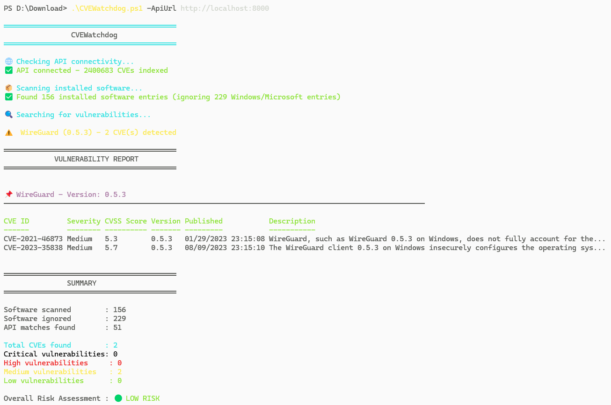

# CVEWatchdog 🔍

**CVEWatchdog** is a cross-platform vulnerability scanner that identifies CVEs (Common Vulnerabilities and Exposures) on installed software. Its server embeds the [FastCVE](https://github.com/Goultarde/FastCVE-API) engine and can enrich reports with SploitScan.

## 🚀 Features

- **Automated scanning** of installed software
- **Embedded FastCVE engine** with no separate API service to install
- **NVD version-range matching** before a CVE is reported
- **Detailed CVE reports** with CVSS scores and severity levels
- **Explicit unresolved/API-error reporting** in debug mode
- **Comprehensive summary** with overall risk assessment
- **Standalone filterable HTML reports** for sharing and archiving scan results
- **Optional SploitScan enrichment** with EPSS, CISA KEV, patching priority, and public exploit counts
- **Client/server mode** for generating enriched reports away from scanned Windows hosts
- **Cross-platform support** (Windows & Linux)

## 📋 Requirements

### Windows

- **PowerShell 5.0+** (Windows 10/11 or Server 2016+)
- A reachable **CVEWatchdog Server** for remote report generation
- Administrator access to read Windows Registry

### Linux

- **Python 3.9+**
- **10+ GB of free disk space** on the server for NVD data
- Root or sudo access to read package information
- **Supported package managers:**
  - dpkg (Debian/Ubuntu)
  - rpm (RedHat/Fedora/CentOS)
  - pacman (Arch Linux)
  - apk (Alpine Linux)

## 🛠️ Installation

### Windows

```bash
# Clone the repository
git clone https://github.com/Goultarde/CVEWatchdog.git
cd CVEWatchdog

# Set execution policy to allow script execution
Set-ExecutionPolicy -ExecutionPolicy RemoteSigned -Scope CurrentUser
```

### Linux

```bash
# Clone the repository
git clone https://github.com/Goultarde/CVEWatchdog.git
cd CVEWatchdog

# Install the Python client
pipx install .

# Update an existing installation
pipx upgrade cvewatchdog
```

### CVEWatchdog Server

The server receives software inventories, resolves them through its embedded FastCVE
engine, optionally enriches their CVEs with SploitScan, and stores the generated HTML reports.

```bash
cd CVEWatchdog
pipx install . --force
pipx install sploitscan

cvewatchdog-server \
  --host 0.0.0.0 \
  --port 8002 \
  --data-path ~/.local/share/cvewatchdog/fastcve
```

This first server version has no authentication or TLS. Bind it only to a trusted
laboratory network. Reports are stored under `~/.local/share/cvewatchdog/reports` by
default; use `--reports-dir` to change that location. FastCVE data is stored under
`~/.local/share/cvewatchdog/fastcve` by default. The first startup downloads and indexes
the NVD datasets and requires 10+ GB of free disk space.

To keep using an existing standalone FastCVE-API instead of the embedded engine:

```bash
cvewatchdog-server --fastcve-url http://127.0.0.1:8001 --host 0.0.0.0 --port 8002
```

## 🎯 Usage

Check the integrated server from another terminal:

```bash
curl http://localhost:8002/health
```

Wait until `/health` reports `"fastcve":"embedded"` before sending an inventory.

### Windows

Recommended client/server usage:
```powershell
.\CVEWatchdog.ps1 `
  -ServerUrl "http://<IP_DU_SERVEUR>:8002" `
  -HtmlReport ".\cvewatchdog-report.html"
```

Advanced options:
```powershell
# Generate the remote report without SploitScan enrichment
.\CVEWatchdog.ps1 -ServerUrl "http://<IP_DU_SERVEUR>:8002" -NoSploitScan

# Legacy direct mode with a standalone FastCVE-API
# Show CPE resolution details
.\CVEWatchdog.ps1  -ApiUrl http://localhost:8001 -DebugMatching

# Specify custom API URL
.\CVEWatchdog.ps1 -ApiUrl "http://<IP_DU_SERVEUR>:8001"
```

### Linux

Recommended client/server usage:
```bash
cvewatchdog --server-url http://<IP_DU_SERVEUR>:8002 --html-report cvewatchdog-report.html
```

Advanced options:
```bash
# Disable server-side SploitScan for a faster remote report
cvewatchdog --server-url http://<IP_DU_SERVEUR>:8002 --no-sploitscan

# Legacy direct mode with a standalone FastCVE-API
# Show the selected CPE and confidence score
cvewatchdog http://localhost:8001 --debug

# Specify custom API URL
cvewatchdog http://<IP_DU_SERVEUR>:8001

# Generate a standalone HTML report
cvewatchdog http://localhost:8001 --html-report cvewatchdog-report.html

# Add SploitScan threat intelligence to the same report
pipx install sploitscan
cvewatchdog http://localhost:8001 --html-report cvewatchdog-report.html --sploitscan

```

The HTML report can be filtered locally by software, CPE, CVE, CWE, description, severity,
or inferred vulnerability type (LPE, RCE, privilege escalation, DoS, information
disclosure, authentication bypass, XSS, SQL injection, or path traversal).
The CWE selector includes weakness names from the bundled MITRE CWE catalog.
Its opening software list shows the number of CVEs per vulnerable application and
can display all, none, one, or any selected combination of applications.
SploitScan enrichment is opt-in because it performs several online lookups for every
unique CVE and can take a long time on large reports.
In client/server mode it is enabled by default and runs only on the server. Windows
therefore needs neither Python, FastCVE-API, nor SploitScan.

## 📊 Output

The script generates a structured report with:

- **Vulnerable software list** with detailed CVE information
- **CVE table** containing:
  - CVE ID
  - CWE identifiers
  - Severity level (Critical/High/Medium/Low)
  - CVSS Score
  - Vulnerable version or NVD range
  - Publication date
  - Description

- **Summary** with:
  - Total CVEs found
  - Breakdown by severity
  - Overall risk assessment (🟢 LOW / 🟡 MEDIUM / 🔴 HIGH / ⚫ CRITICAL)

Wildcard CPE entries are evaluated by FastCVE-API together with their NVD version bounds. The legacy `-Wildcards`/`--wildcards` option is still accepted for command compatibility but is no longer needed.

## How matching works

In client/server mode, clients send their inventory to CVEWatchdog Server. Its embedded
FastCVE engine resolves each display name to a CPE and keeps only NVD entries matching
the installed version and platform. Legacy direct mode sends those entries to a
standalone FastCVE-API through `POST /api/resolve`. A resolved product with no CVE is
kept distinct from an unresolved product or an API failure.

## Tests

Python client:

```bash
python3 -m unittest discover -s tests -v
```

PowerShell client (requires Pester 5):

```powershell
Invoke-Pester .\tests\CVEWatchdog.Tests.ps1
```



## 🤝 Contributing

Contributions are welcome!
